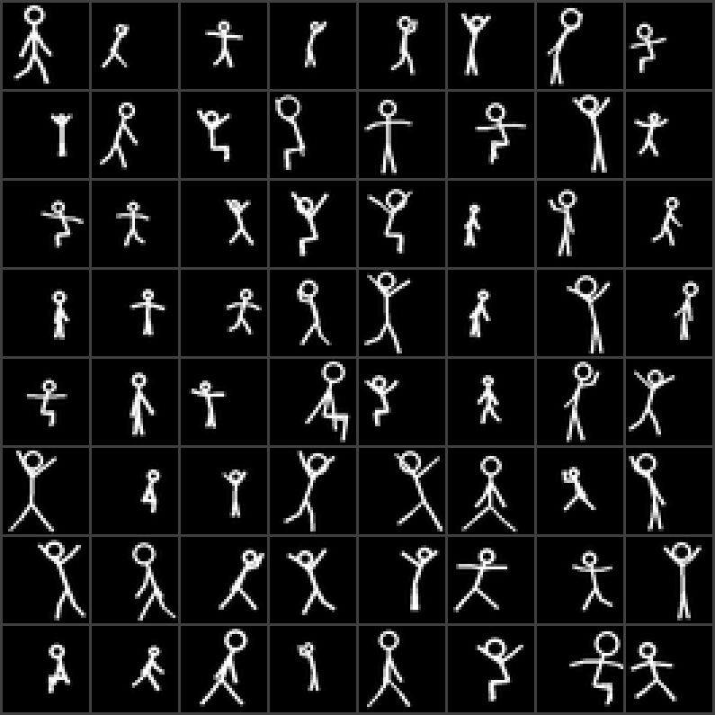
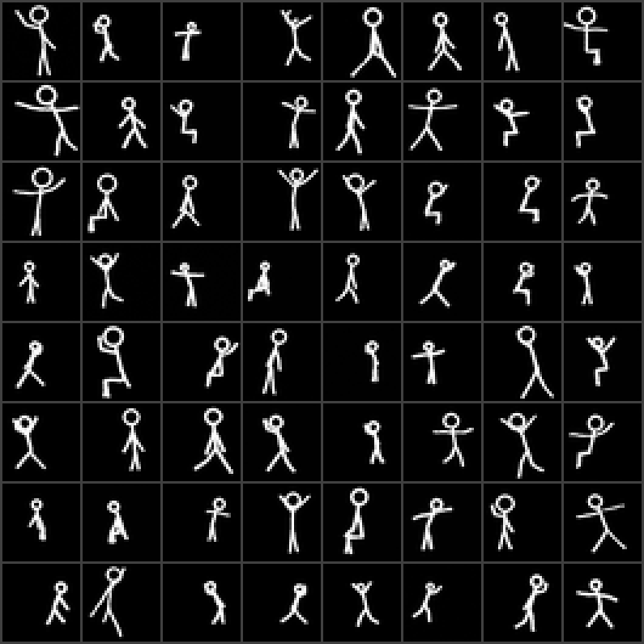
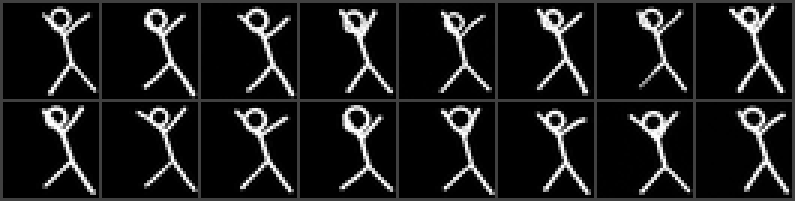
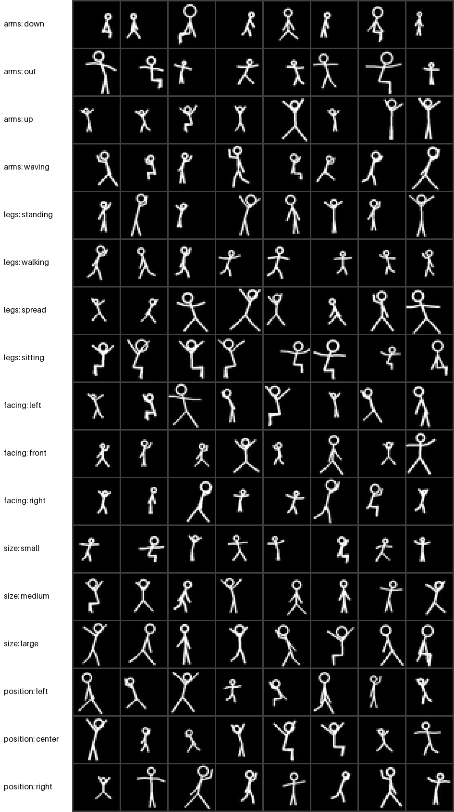
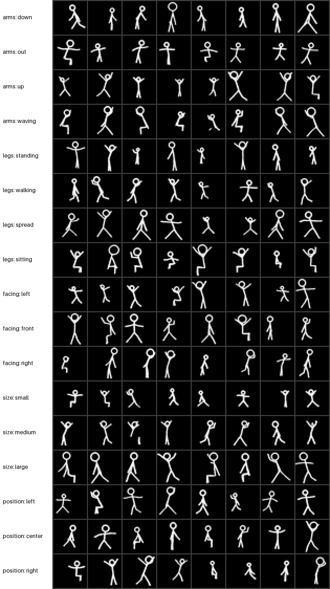
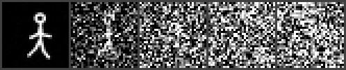
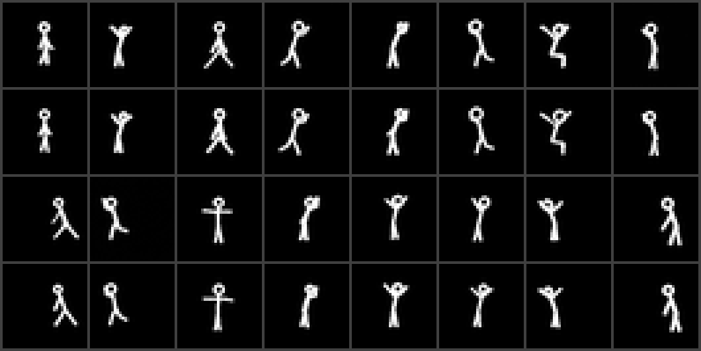
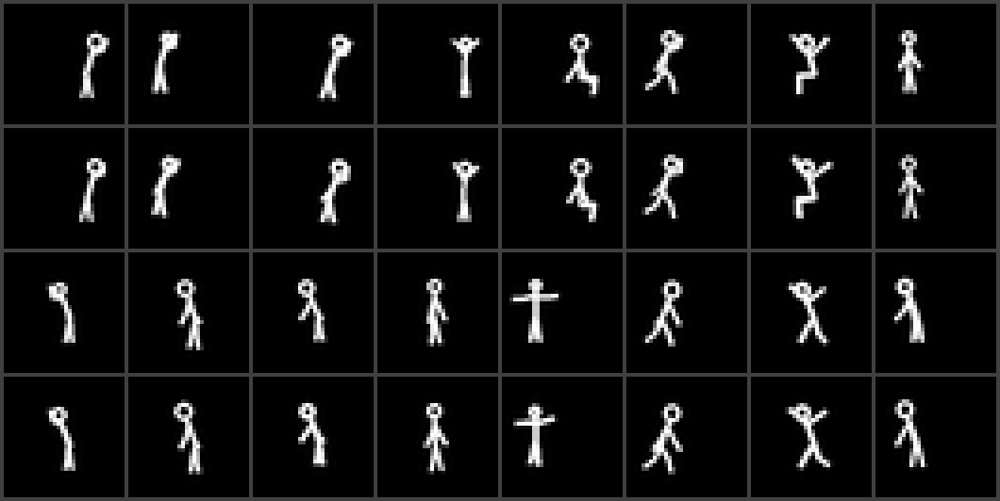
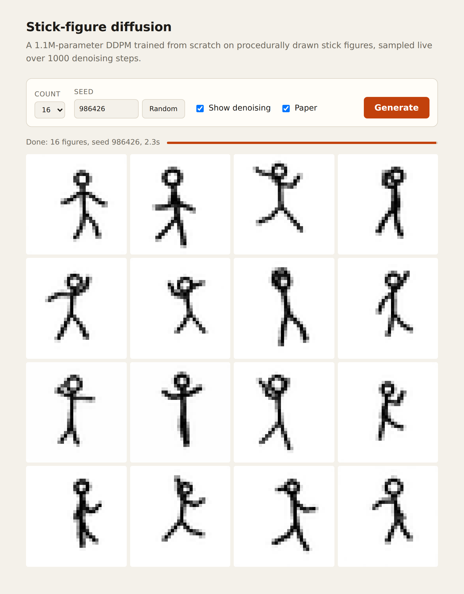

# stick-diffusion

A tiny image diffusion model, written and trained from scratch, that generates 32×32 stick figures. You can tell it what kind of figure you want: arm and leg pose, which way it faces, its size and its position.

It is a proof of concept, not a good model. There are no pretrained weights, no LoRA and no `diffusers`. The noise schedule, sampler, guidance and network are about 170 lines of plain PyTorch. The training data isn't generated by an AI model either: a short script draws stick figures with random poses and labels each one. The code itself was written with an AI coding assistant; see [AI disclosure](#ai-disclosure).

| Training data (procedural) | Model samples (nothing requested) |
| --- | --- |
|  |  |

Most samples are recognisable figures. Some come out with fused or missing limbs.

## Controlling the figure

Each figure is described by five attributes. Any of them can be left as "any", in which case it varies:

| attribute | values |
| --- | --- |
| arms | down, out, up, waving |
| legs | standing, walking, spread, sitting |
| facing | left, front, right (the torso leans that way, and waving, walking and sitting point that way) |
| size | small, medium, large |
| position | left, center, right |

```sh
uv run python sample.py --arms up --legs spread --facing left --size large --position right
```



Each row on the right asks for one attribute value and leaves the other four on "any". The left side shows training figures with that label:

| Training figures with that label | Model samples asked for that value |
| --- | --- |
|  |  |

### Does it actually follow the request?

`eval_cond.py` trains a small classifier on fresh procedural figures to read the five attributes back from a 32×32 image, then grades the model's samples with it. Numbers are the % of samples showing the requested value:

| | arms | legs | facing | size | position |
| --- | --- | --- | --- | --- | --- |
| chance | 25.0 | 25.0 | 33.3 | 33.3 | 33.3 |
| classifier on real figures (ceiling) | 100.0 | 99.9 | 100.0 | 100.0 | 100.0 |
| all five requested, guidance 1 | 99.0 | 98.6 | 97.6 | 98.4 | 100.0 |
| all five requested, guidance 2 (default) | 100.0 | 100.0 | 99.8 | 100.0 | 100.0 |
| one requested, rest "any", guidance 2 | 99.6 | 99.6 | 99.4 | 100.0 | 100.0 |
| control: nothing requested | 25.4 | 25.0 | 33.4 | 34.2 | 33.4 |

The control row is graded against random labels and lands at chance, so the high scores come from the conditioning, not from a lenient classifier. Each generated row uses 500 samples; the ceiling uses 5,000 real figures. Guidance 3 and 5 also score 100%; side by side, samples at 5 looked no different from 2.

## How it works

- **Data** (`data.py`):
  - Each figure is a skeleton: a head, a torso, and two arms and two legs with elbow and knee joints.
  - The five attributes are sampled first. They pick the angle ranges for the joints, the lean and facing side, the figure's height in the frame, and where the torso sits. Limb lengths, exact angles and line width are random within those ranges.
  - If a figure doesn't fit the frame at its size and position, it is re-drawn rather than shifted, so labels match pixels. After 30 failed tries it accepts a figure clipped at the frame edge.
  - Figures are drawn at 128×128 with PIL and downsampled to 32×32 grayscale. Training uses 50,000 of them, generated in about 9 seconds and kept on the GPU.
- **Model** (`model.py`): a small UNet with 1.11M parameters.
  - It has three resolution levels (32 → 16 → 8), ResBlocks with GroupNorm and SiLU, and no attention.
  - Conditioning: each attribute has an embedding table with one extra "any" entry, and the five embeddings are added to the sinusoidal timestep embedding. That is 2,816 parameters.
- **Diffusion** (`diffusion.py`): [DDPM](https://arxiv.org/abs/2006.11239) with T = 1000 steps and a linear β schedule. The network predicts the added noise and is trained with MSE loss; sampling uses DDPM's step-by-step (ancestral) sampler.
  - **Training dropout:** each attribute is independently replaced by "any" 20% of the time, which teaches the model partial requests. The whole label is dropped 10% of the time, which gives the unconditional model.
  - **Sampling** uses [classifier-free guidance](https://arxiv.org/abs/2207.12598): ε = ε_any + w·(ε_requested − ε_any), with w = 2 by default.
- **Training** (`train.py`): 20k steps of AdamW (lr 3e-4, batch 256), with an exponential moving average (EMA) of the weights used for sampling. This took 9 minutes on an RTX 4080.

The forward process noises a figure at t = 0, 250, 500, 750 and 999:



## Quickstart

Requires Python 3.13+ and [uv](https://docs.astral.sh/uv/). An NVIDIA GPU is strongly recommended; CPU works but training will be slow.

The repo ships trained weights (`weights/stick-diffusion.pt`, 4.5 MB), so you can sample straight away:

```sh
uv sync
uv run python ui.py        # web UI at http://localhost:8000
uv run python sample.py    # writes out/generated.png (--n, --seed, --guidance, --arms, --legs, ...)
```

To train your own model:

```sh
uv run python data.py      # optional: writes out/real_grid.png and out/real_attrs.png, previews of the training data
uv run python train.py     # writes out/ckpt.pt plus attribute-sweep grids every 5k steps
uv run python eval_cond.py # optional: grades how well samples follow the requested attributes (about 6 min on an RTX 4080)
```

`sample.py`, `ui.py`, `eval_cond.py` and `memorization.py` use your own `out/ckpt.pt` if it exists, otherwise the shipped weights. Pass `--ckpt` to choose one explicitly.

`uv run python train.py --overfit --steps 2000 --batch 64` is a useful sanity check: it trains on the first 16 training figures, and each sample should reproduce the figure whose labels it was given. If they come out as grey mush, the schedule or sampler is broken.

## Does it copy the training data?

None of the 1,000 samples checked is a pixel-level copy of a training image, and generated figures are no closer to the training set than brand-new procedural figures are. The evidence is statistical: at this resolution, even brand-new figures have near-identical twins in the training set.

`memorization.py` generates 1,000 samples and finds each one's nearest neighbour among the 50,000 training images, using per-pixel RMS distance with pixels in [-1, 1]. It compares them with two reference groups:

- **held-out:** 1,000 fresh procedural figures the model never saw, with the same requested attributes. This shows what a "new" figure looks like.
- **control:** 256 samples from a model deliberately overfit on the first 16 training figures (`train.py --overfit`). This shows what copying looks like through the same sampler.

| group | min | median | max |
| --- | --- | --- | --- |
| generated, nothing requested | 0.083 | 0.264 | 0.487 |
| held-out (new figures) | 0.101 | 0.239 | 0.442 |
| generated, fixed request (waving, walking, right, medium, center) | 0.108 | 0.215 | 0.292 |
| held-out with the same request | 0.105 | 0.224 | 0.334 |
| control (copies) | 0.013 | 0.022 | 0.074 |

Close matches are rarer for generated figures than for new ones: 1.6% of generated samples are within 0.14 of a training image, against 3.2% of held-out figures. Two of the 1,000 generated samples are closer than the closest held-out figure (0.083 and below 0.101), but still further than every copy (0.074 at most). `memorization.py` prints all of these numbers.

At 32×32 with 50,000 training figures, the closest pairs look alike either way. Below are the 16 closest pairs for generated samples (top of each pair) and, for comparison, for brand-new procedural figures. The new figures have equally close look-alikes, because the dataset is dense in simple poses:

| Generated vs nearest training image | New figure vs nearest training image |
| --- | --- |
|  |  |

This only rules out pixel-level copies. It doesn't measure how varied the poses are, and a copy shifted by a few pixels would pass. The control needs `out/overfit_ckpt.pt` from the overfit run; without it, that row is skipped.

## Web UI

`ui.py` is a small server built on Python's standard library. It loads the checkpoint once and streams the denoising process to the page as server-sent events, so you can watch figures form out of noise.

- **Attributes:** a dropdown for each, plus a guidance slider. The slider is greyed out when everything is on "Any", because guidance has no effect then.
- **Other controls:** number of figures, seed, live preview on/off, and a black-on-white "paper" view.
- **Speed:** sampling 16 figures over the full 1000 steps with guidance takes about 2.5 seconds on an RTX 4080.



## Files

```
data.py          procedural stick-figure renderer, attribute definitions and dataset
model.py         UNet, timestep and attribute embeddings, checkpoint loading
diffusion.py     noise schedule, training loss, guided sampler
train.py         training loop (EMA, periodic sample grids and checkpoints)
sample.py        generate a grid from a checkpoint, with optional attributes
ui.py            local web UI server
ui.html          web UI page
eval_cond.py     grades how well samples follow the requested attributes
memorization.py  nearest-neighbour check against the training set
weights/         pretrained checkpoint (EMA weights after 20k steps)
```

## AI disclosure

"From scratch" here describes the model and its training data, not how the repository was built.

- **The model and data don't come from AI:**
  - The diffusion model starts from random weights and learns only from the procedurally drawn figures in `data.py`.
  - No pretrained model, fine-tuning, LoRA or AI-generated images are involved anywhere in training.
- **The repository was built with AI:** it was developed with [Claude Code](https://claude.com/claude-code), Anthropic's AI coding assistant, under human direction. That covers the code (including the stick-figure generator), the evaluation scripts, the web UI, this README and the repository setup. Commits it co-authored are marked with a `Co-Authored-By: Claude` trailer.

## License

MIT, see [LICENSE](LICENSE).

This repository contains only original code. No third-party code or assets are vendored, and the web UI loads nothing from CDNs. The dependencies (PyTorch, NumPy, Pillow, plus the NVIDIA CUDA libraries PyTorch pulls in on Linux) are installed separately and come under their own licenses.
